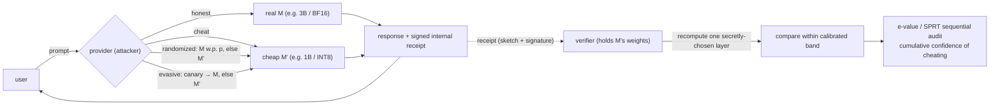
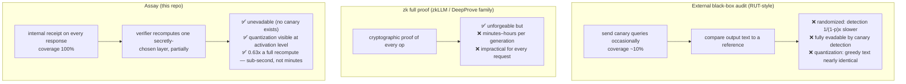

# Assay — detecting model substitution with per-request internal receipts

[](https://github.com/NagaYu/assay/actions/workflows/ci.yml)
[](LICENSE)
[](pyproject.toml)

> **Catch subtle and evasive model swaps in fewer queries than an external
> black-box audit.** Every response ships a signed, low-dimensional sketch of its
> `hidden_states` (an *internal receipt*); a verifier checks it by recomputing only a
> small, secretly-chosen slice — **0.63× a full recompute**, measured. Coverage is
> **100%** by construction — there is no "request the audit happened to miss."

A research prototype for detecting **model substitution**: an inference provider
that advertises a real model **M** but quietly serves a cheaper **M'** (a smaller
model, or a lower-precision quantization) on some or all requests. Assay flags this
*per request*, and stays robust to the two attacks that defeat external audits:
**randomized** substitution and **canary-aware evasion**.

> ⚠️ Research prototype, not a production security system. The TEE is simulated with a
> plain signature and the "cheap model" is a CPU stand-in — see
> [Limitations and honest caveats](#limitations-and-honest-caveats).

---

## Threat model

The provider is adversarial and mixes strategies:



- **What the provider can do.** For a response generated by M', build the *best
  possible fake receipt* from M''s own activations (if the layer counts differ, map
  proportionally: shallow layers → shallow layers). It owns the receipt signing key
  (the TEE is simulated). It can replay old honest receipts, re-pick sketch positions,
  or reuse one attested receipt for many served responses — all of which are rejected
  by the structural check (hash binding, PRF re-derivation, and request-id binding).
- **What the provider cannot do.** Learn M's `hidden_states` *without running M*.
  That is the crux: only someone who actually ran M can produce a receipt that
  matches M's activations.
- **The verifier** holds M's weights and a secret RNG, and picks which layer to
  recompute in a way the provider cannot predict.

## Why external sampling audits get evaded, and zk is too slow



|  | Coverage | Randomized swap | Audit evasion | Quantization swap | Verify cost |
|---|---|---|---|---|---|
| Black-box audit | ~10% (audit queries only) | 1/(1-p)× slower | **impossible in principle** | nearly invisible | low |
| zk full proof | 100% | detectable | detectable | detectable | **minutes–hours per generation** |
| **Assay** | **100%** | **~10 requests** | **~1 request** | **visible in 1 request** | 0.63× a full recompute |

## How it works (four components)

```mermaid
sequenceDiagram
    participant U as user
    participant P as provider (+ simulated TEE)
    participant V as verifier (holds M)
    U->>P: prompt (request_id)
    P->>P: generate + capture hidden_states
    P->>P: ActivationSketch: JL projection (positions from PRF(seed, request_id); layer set is a fixed protocol constant)
    P->>U: response + signed receipt
    U->>V: (prompt, response, receipt)
    V->>V: structural check (hash binding, signature, PRF derivation)
    V->>V: pick one layer with secret RNG -> truncated forward, partial recompute
    V->>V: standardize within calibrated band -> z, then p
    V->>V: SequentialAudit: accumulate e-value, alarm when log E ≥ log(1/α)
```

1. **ActivationSketch** ([assay/sketch.py](assay/sketch.py)) — projects selected
   layers × token positions of `hidden_states` through a fixed-seed **JL random
   projection** into k=32 dims, and also computes **coarse invariant features**
   (sign bits, top-rank order). The *inspection positions* are derived from
   `PRF(seed, request_id)`; the *layer set* is a fixed public protocol constant (the
   verifier draws which one to recompute from its own secret RNG). The receipt is
   signed with HMAC or ed25519 (simulating a TEE attestation).
2. **Verifier** ([assay/verifier.py](assay/verifier.py)) — holds M's weights and
   recomputes **exactly one secretly-chosen layer** with the same projection. A
   **truncated forward** — only the blocks below that layer, only the tokens up to the
   last inspected position (causality makes later tokens irrelevant), and never the
   `lm_head` — brings this to **0.63× a full recompute**, measured on every request.
   This is a constant-factor saving, not an asymptotic one: the blocks *below* the drawn
   layer still run, so cost scales with that layer's depth (~2/3 of full in expectation).
3. **NondeterminismModel** ([assay/nondeterminism.py](assay/nondeterminism.py)) —
   injects ~3e-4 relative noise into each block output to model *benign*
   nondeterminism (GPU reduction order, kernel choice). The tolerance band is
   calibrated *with* this jitter, so it never causes a false alarm.
4. **SequentialAudit** ([assay/sequential_audit.py](assay/sequential_audit.py)) —
   combines per-request p-values into a mixture e-value
   `e(p) = (1-λ) + λ·κ·p^(κ-1)`. By Ville's inequality this is **anytime-valid**
   (false-alarm probability ≤ α no matter when you look) — a running "cumulative
   confidence of cheating." An SPRT variant is included for comparison.

The attacker is modeled by `ProviderServer` in
[assay/server.py](assay/server.py) (modes: honest / cheat / random / evasive).

## Benchmark

The default model pair runs end-to-end on **CPU**:
**M = gpt2 (124M, 12 layers) / M' = distilgpt2 (82M, 6 layers)** for the size swap,
and **M = gpt2 FP32 / M' = same model INT8 fake-quant** for the precision swap.
Swap in a Llama pair with
`--model-m meta-llama/Llama-3.2-3B --model-mp meta-llama/Llama-3.2-1B` (GPU
recommended). On a CUDA host, `load_int8_model(name, device="cuda:0")` uses the real
bitsandbytes `LLM.int8()`; the benchmark harness itself runs on CPU by default.

```bash
python benchmarks/run.py               # full run (gpt2 pair, ~10 min on CPU)
python benchmarks/run.py --pair tiny --quick   # random-init tiny pair, ~1 min
```

<!-- BENCH_TABLE_START -->
| Scenario | Assay detect (req) | BB 10% interleaved | BB dedicated | Distribution BB | AUC |
|---|---|---|---|---|---|
| Full substitution | 1 | 30 | 2 | 5 | 1.000 |
| Quantization | 1 | 19 | 2 | 10 | 1.000 |
| Randomized p=0.9 | 11 | **not detected** | **not detected** | **not detected** | 1.000 |
| Audit evasion | 1 | **not detected** | **not detected** | 5 | 1.000 |

- Honest operation: sequential false alarm = no, per-request FPR(z>3.09) = 0.000
- Verifier cost ratio: layer-token 0.63 / wall 0.72 (full recompute = 1.0)
- Coverage: Assay 100% / BB 10%
- Config: pair=gpt2, n=80/scenario, trials=3, alpha=0.01 (CPU)
<!-- BENCH_TABLE_END -->

*"Queries to detection" is the median over trials; **not detected** means the method
did not alarm within the request budget (n=80). "Distribution BB" is a passive
unigram-distribution test over the user-traffic text.*

*Methodology: the prompt pool is split into disjoint halves — the tolerance band is
calibrated on one half, and every scenario (including the honest control that produces
the false-positive rate) runs on the other. The black-box baseline is given every
advantage the setting allows: its canary references come from a clean run of M, its
honest mismatch rate `q0` is calibrated the same way, and it additionally gets a
**dedicated** mode where it spends its whole query budget on canaries with no user
traffic in the way.*

### Headline figure


Under **randomized (p=0.9)** and **audit-evasion** substitution, the black-box audit
(green) accumulates no evidence — under evasion it stays flat **forever**. Assay
(blue) attaches a receipt to *every* request, so evidence jumps the moment a cheating
request appears and crosses the threshold within a handful of requests.

| | |
|---|---|
|  |  |
|  |  |

## Install

```bash
git clone https://github.com/NagaYu/assay.git
cd assay
pip install -e .            # torch, transformers, numpy, matplotlib, cryptography
pip install -e ".[test]"    # + pytest, to run the test suite
```

Python 3.10+; CPU is sufficient. The gpt2/distilgpt2 weights are downloaded from the
Hugging Face Hub on first benchmark run; the test suite needs no network.

## Verified claims (pytest)

```bash
python -m pytest tests -q    # no network, seeded tiny models, ~5 s
```

| Claim | Test |
|---|---|
| No false alarm under honest operation (with jitter) | `test_honest_no_false_alarm` |
| Size / quantization swaps detected within threshold | `test_detect_size_substitution` / `test_detect_quantization` |
| Invariants stable under jitter (jitter ≪ quant ≪ swap) | `test_invariants_stable_under_jitter_sensitive_to_swap` |
| Verifier cost below full recompute | `test_verifier_cost_below_full_recompute` |
| Truncated forward matches full forward exactly | `test_truncated_forward_matches_full` |
| Replay / tamper / position re-pick rejected by structural check | `test_replay_rejected` and others |
| One receipt cannot cover several served responses | `test_receipt_bound_to_request_id` |
| Anytime false-alarm control of the e-process (Monte Carlo) | `test_evalue_anytime_validity_monte_carlo` |
| **Evasive server fools the black box but not Assay (headline)** | `test_evasive_server_fools_blackbox_but_not_assay` |

## Repository layout

```
assay/
  hooks.py             # model loading, hidden_states capture, INT8 fake-quant, PRF
  sketch.py            # ActivationSketch + invariant features + signed receipt
  verifier.py          # partial-recompute verifier (truncated forward, calibration, cost)
  nondeterminism.py    # benign jitter injection + invariant-feature utilities
  sequential_audit.py  # e-value / SPRT sequential audit
  server.py            # attacker-modeled provider (honest/cheat/random/evasive)
benchmarks/
  run.py               # benchmark driver (4 scenarios × Assay vs BB; makes figures + table)
  blackbox.py          # black-box audit baselines (canary matching, distribution test)
  figures.py           # figure generation
tests/                 # pytest for the claims above (hermetic, seconds on CPU)
figures/               # figures produced by the benchmark run
```

## Limitations and honest caveats

- **No zk full proof.** The comparison to zkLLM / DeepProve is at the design-goal
  level only; Assay deliberately targets a lightweight, every-request, internal check.
- **The TEE is simulated with a cryptographic signature.** In a real deployment the
  receipt would be produced inside an enclave whose key is bound to the code
  identity. Here the signature only prevents receipt tampering / forgery / replay;
  substitution detection itself comes from sketch consistency.
- **Quantization on CPU is fake-quant** (the same per-channel absmax INT8 as
  bitsandbytes). On CUDA, `load_int8_model(..., device="cuda")` uses real INT8
  (LLM.int8()); the benchmark harness runs on CPU by default.
- **Nondeterminism is a model** (~3e-4 per-layer relative noise). The robustness
  claim is that the separation holds even when calibrated against jitter that is
  deliberately *larger* than typical measured GPU nondeterminism.
- **The verifier's p-value** is a Gaussian-tail approximation to a calibrated
  log-distance (clamped at p ≥ 1e-12). The empirical tail can be slightly heavier
  than Gaussian, so the per-request FPR at z>3.09 may sit at or a little above the
  Gaussian nominal; the sequential audit's false-alarm control is nonetheless
  verified both by Monte Carlo and on honest traffic, and the e-value's `(1-λ)`
  floor bounds the impact of any single anti-conservative p-value.
- **Receipt computation** is done here with a teacher-forcing re-pass for
  implementation simplicity; in production the activations are already computed at
  serving time and would be reused (this cost is therefore excluded from the
  verifier cost ratio).

## Citation

```bibtex
@software{assay2026,
  title  = {Assay: per-request internal receipts for model-substitution detection},
  author = {Nagao, Yuta},
  year   = {2026},
  url    = {https://github.com/NagaYu/assay},
  note   = {Research prototype}
}
```

## License

[MIT](LICENSE).
