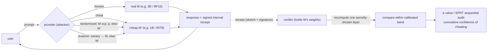
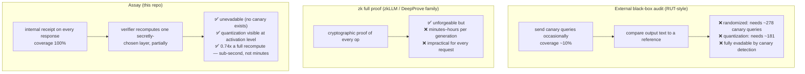
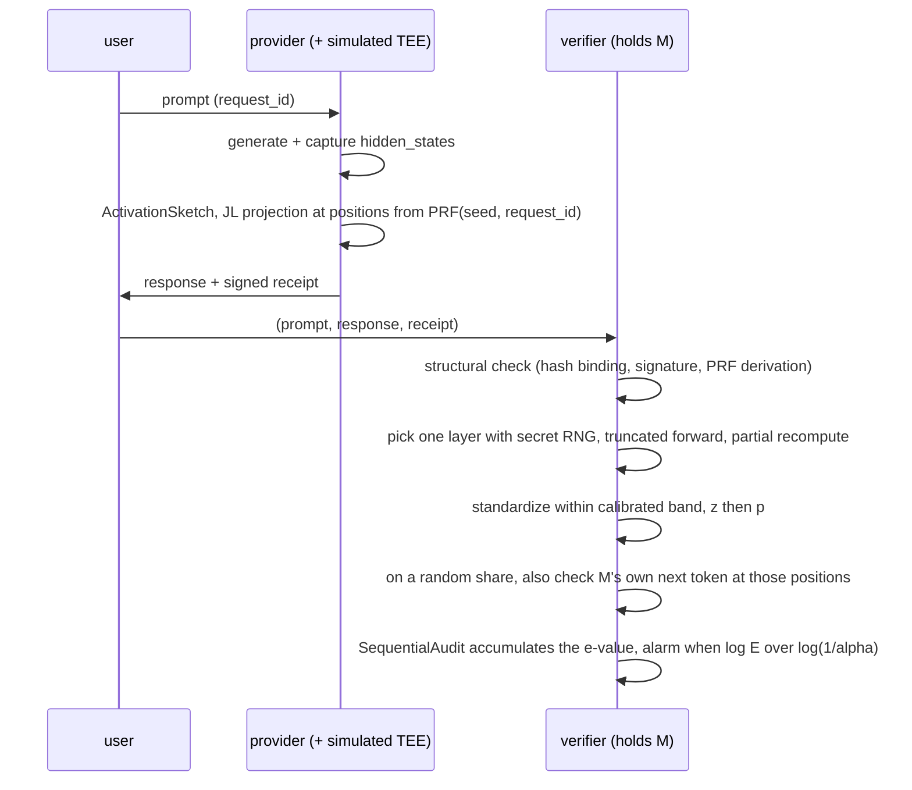
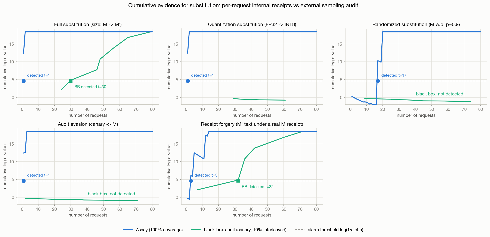
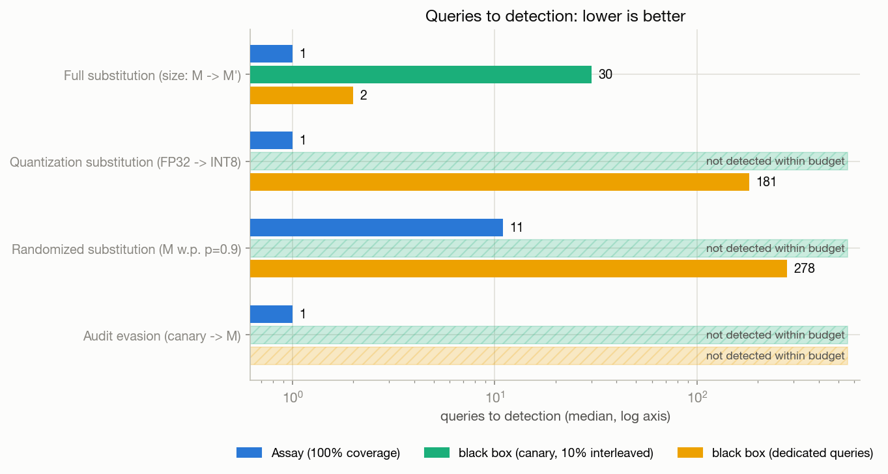
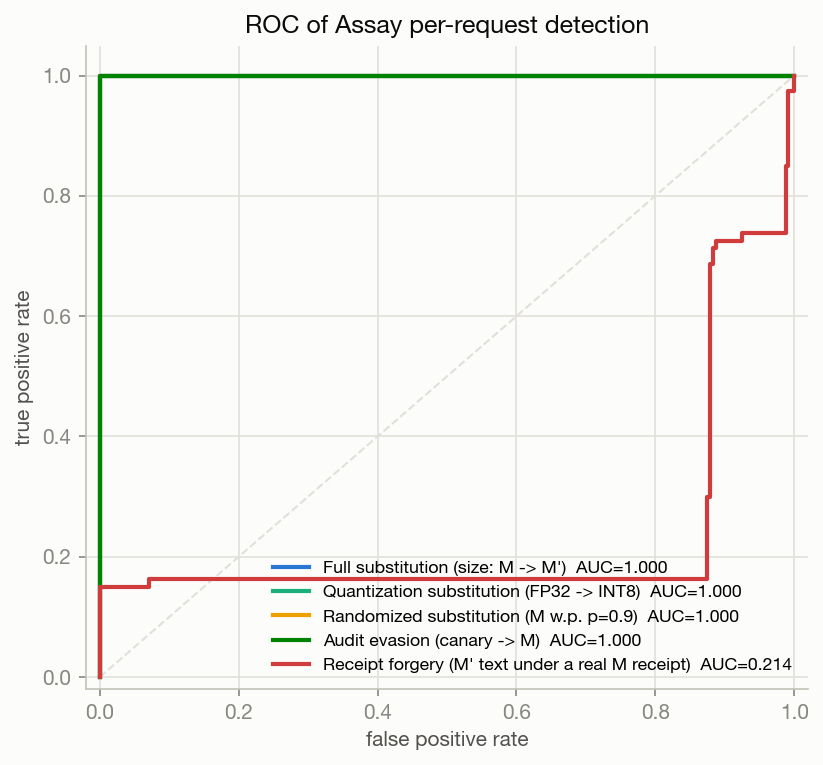
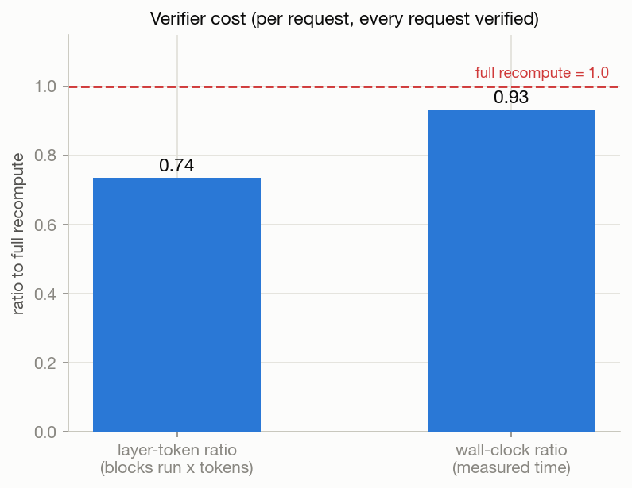
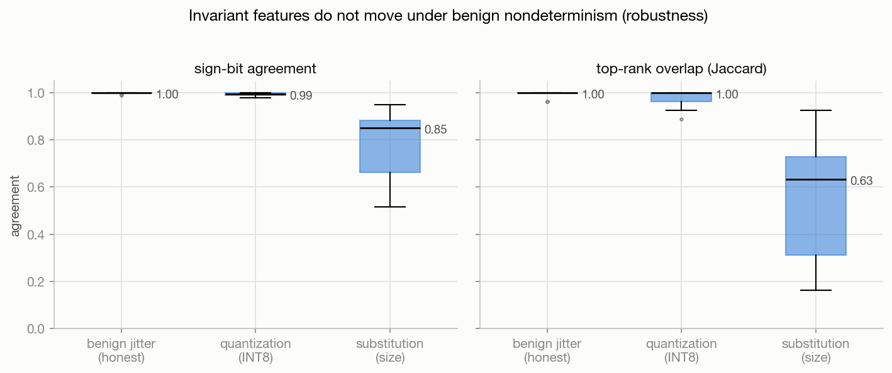

# Assay — detecting model substitution with per-request internal receipts

[](https://github.com/NagaYu/assay/actions/workflows/ci.yml)
[](LICENSE)
[](pyproject.toml)

> **Catch subtle and evasive model swaps in fewer queries than an external
> black-box audit.** Every response ships a signed, low-dimensional sketch of its
> `hidden_states` (an *internal receipt*); a verifier checks it by recomputing only a
> small, secretly-chosen slice — **0.74× a full recompute**, measured. Coverage is
> **100%** by construction — there is no "request the audit happened to miss."

A research prototype for detecting **model substitution**: an inference provider
that advertises a real model **M** but quietly serves a cheaper **M'** (a smaller
model, or a lower-precision quantization) on some or all requests. Assay flags this
*per request*, and stays robust to the two attacks that defeat external audits —
**randomized** substitution and **canary-aware evasion** — as well as to a third that
defeats naive internal receipts: a provider that serves M' text under a **genuine M
receipt** (see [the attack a sketch alone cannot see](#the-attack-a-sketch-alone-cannot-see)).

> ⚠️ Research prototype, not a production security system. The TEE is simulated with a
> plain signature and the "cheap model" is a CPU stand-in — see
> [Limitations and honest caveats](#limitations-and-honest-caveats).

---

## Threat model

The provider is adversarial and mixes strategies:



- **What the provider can do.** For a response generated by M', build the *best
  possible fake receipt* from M''s own activations (if the layer counts differ, map
  proportionally: shallow layers → shallow layers). It owns the receipt signing key
  (the TEE is simulated). It can replay old honest receipts, re-pick sketch positions,
  or reuse one attested receipt for many served responses — all of which are rejected
  by the structural check (hash binding, PRF re-derivation, and request-id binding).
  And it can do something subtler, described next.
- **What the provider cannot do.** Learn M's `hidden_states` *without running M*.
  That is the crux — but it is a narrower guarantee than it first looks, and the gap is
  a real attack rather than a hypothetical one.
- **The verifier** holds M's weights and a secret RNG, and picks which layer to
  recompute — and whether to run the deep check — in a way the provider cannot predict.

### The attack a sketch alone cannot see

Matching sketches prove that M was **run over** a token sequence. They do not prove M
**produced** it. So a provider can:

1. decode cheaply with M' — the user gets M' quality;
2. push `(prompt + M' output)` through M once with teacher forcing;
3. read the sketch off *that* pass and sign it.

The receipt is genuinely M's. Every hash binds, every position re-derives, the sketch
distance is not merely acceptable but *better than honest* — the forger recomputes without
the jitter a real serving stack has. It is also cheaper than serving M: one parallel prefill
instead of a sequential decode.

`ProviderServer(mode="forge")` implements it, and
`tests/test_forgery.py::test_forgery_defeats_the_sketch_check_alone` asserts that the sketch
check **never** catches it. What closes the gap is that a teacher-forced pass also reveals
what M *would* have said: at an inspected position, M's own next-token argmax is compared
against the token the provider actually returned. That needs the full stack (logits come
through `lm_head`), so it runs on a random `deep_check_rate` share of requests — the
provider cannot tell which — and the forgery is caught within a handful of them.

## Why external sampling audits get evaded, and zk is too slow



|  | Coverage | Randomized swap | Audit evasion | Quantization swap | Verify cost |
|---|---|---|---|---|---|
| Black-box audit | ~10% (audit queries only) | 278 dedicated queries | **impossible in principle** | 181 dedicated queries | low |
| zk full proof | 100% | detectable | detectable | detectable | **minutes–hours per generation** |
| **Assay** | **100%** | **11 requests** | **1 request** | **1 request** | 0.74× a full recompute |

## How it works (four components)



1. **ActivationSketch** ([assay/sketch.py](assay/sketch.py)) — projects selected
   layers × token positions of `hidden_states` through a fixed-seed **JL random
   projection** into k=32 dims, and also computes **coarse invariant features**
   (sign bits, top-rank order). The *inspection positions* are derived from
   `PRF(seed, request_id)`; the *layer set* is a fixed public protocol constant (the
   verifier draws which one to recompute from its own secret RNG). The receipt is
   signed with HMAC or ed25519 (simulating a TEE attestation).
2. **Verifier** ([assay/verifier.py](assay/verifier.py)) — holds M's weights and
   recomputes **exactly one secretly-chosen layer** with the same projection. A
   **truncated forward** — only the blocks below that layer, and only the tokens up to the
   last inspected position (causality makes later tokens irrelevant) — keeps this below a
   full recompute, measured on every request. It is a constant-factor saving, not an
   asymptotic one: the blocks *below* the drawn layer still run, so cost scales with that
   layer's depth. (Both the numerator and the denominator exclude `lm_head`, so skipping it
   is not part of the saving — the ratio compares transformer blocks to transformer blocks.)
   On a random `deep_check_rate` share of requests the verifier instead runs the full depth,
   for the generation-consistency check that catches a forged receipt; that pass is shared
   between the two checks, so a deep-checked request still costs at most one full recompute.
3. **NondeterminismModel** ([assay/nondeterminism.py](assay/nondeterminism.py)) —
   injects ~3e-4 relative noise into each block output to model *benign*
   nondeterminism (GPU reduction order, kernel choice). The tolerance band is
   calibrated *with* this jitter, so it never causes a false alarm.
4. **SequentialAudit** ([assay/sequential_audit.py](assay/sequential_audit.py)) —
   combines per-request p-values into a mixture e-value
   `e(p) = (1-λ) + λ·κ·p^(κ-1)`. By Ville's inequality this is **anytime-valid**
   (false-alarm probability ≤ α no matter when you look) — a running "cumulative
   confidence of cheating." An SPRT variant is included for comparison. The α guarantee is
   stated for exact null p-values; here the tolerance band is estimated from a finite
   calibration sample and shared by every request in a run, so calibration error is a
   common-mode shift rather than independent noise — measured cost in
   [Limitations](#limitations-and-honest-caveats).

The attacker is modeled by `ProviderServer` in
[assay/server.py](assay/server.py) (modes: honest / cheat / random / evasive / forge).

## Benchmark

The default model pair runs end-to-end on **CPU**:
**M = gpt2 (124M, 12 layers) / M' = distilgpt2 (82M, 6 layers)** for the size swap,
and **M = gpt2 FP32 / M' = same model INT8 fake-quant** for the precision swap.
Swap in a Llama pair with
`--model-m meta-llama/Llama-3.2-3B --model-mp meta-llama/Llama-3.2-1B` (GPU
recommended). On a CUDA host, `load_int8_model(name, device="cuda:0")` uses the real
bitsandbytes `LLM.int8()`; the benchmark harness itself runs on CPU by default.

```bash
python benchmarks/run.py                       # full run (gpt2 pair, ~10 min on CPU)
python benchmarks/run.py --pair tiny --quick   # random-init tiny pair, ~1 min
python benchmarks/run.py --deep-check-rate 0   # sketch check only: the forgery goes undetected
```

Only the canonical run (full gpt2 pair) writes `figures/`, `benchmarks/results.{json,md}`
and the table below; smaller runs write to `figures/<tag>/` and `results.<tag>.*` so a smoke
test cannot quietly overwrite the numbers cited here.

<!-- BENCH_TABLE_START -->
| Scenario | Assay detect (req) | BB 10% interleaved | BB dedicated | Distribution BB | AUC |
|---|---|---|---|---|---|
| Full substitution | 1 | 30 | 2 | 5 | 1.000 |
| Quantization | 1 | **not detected** | 181 | **not detected** | 1.000 |
| Randomized p=0.9 | 11 | **not detected** | 278 | **not detected** | 1.000 |
| Audit evasion | 1 | **not detected** | **not detected** | 5 | 1.000 |
| Receipt forgery (M' text, M receipt) | 3 | 31 | 2 | 5 | 0.214 |

- Honest control (3 trials, 240 requests): Assay sequential false alarms 0%, black box 0%, per-request FPR(z>3.09) = 0.000
- Verifier cost ratio: layer-token 0.74 / wall 0.93 (full recompute = 1.0)
- Coverage: Assay 100% / BB 10%
- Config: pair=gpt2, n=80/scenario, trials=3, alpha=0.01 (CPU)
<!-- BENCH_TABLE_END -->

*"Queries to detection" is the median over trials, with undetected trials kept in the
ordering as +infinity (dropping them instead reports a shorter time than actually happened).
**AUC** is per-request, scored on the statistic the audit acts on, `-log10(p)`; the forgery
row is low there on purpose — most of its requests carry no evidence at all, and the ones
that draw the deep check are decisive, which is a detection time of 3 rather than a high
per-request AUC. **not detected** means the method did not alarm within its budget — 80 requests of traffic for Assay and the interleaved black
box, 400 dedicated canary queries for "BB dedicated". "Distribution BB" is a passive
unigram-distribution test over the user-traffic text.*

*Read the rows carefully — the interesting content is in where each method fails.*

- *A dedicated black-box auditor **can** catch randomized substitution (278 canary queries)
  and INT8 quantization (181), it is just slow and it spends its own query budget doing it.
  Assay needs 11 and 1 ordinary user requests respectively, and no extra queries at all.*
- *Audit evasion is the one the black box cannot win at any budget: the canaries are exactly
  the queries that get honest answers.*
- ***Receipt forgery is the mirror image.*** *A provider serving M' text under a real M
  receipt is invisible to the sketch check — but perfectly visible to a black box, because
  the text really is M''s. Assay catches it in 3 requests via the generation-consistency
  check, which is essentially an output comparison done internally, on every request, with
  no canary to detect. Neither method dominates the other on mechanism; Assay's advantage is
  coverage and the absence of anything for the provider to recognize.*

*Methodology: the prompt pool is split into disjoint halves — the tolerance band is
calibrated on one half, and every scenario (including the honest control that produces
the false-positive rate) runs on the other. The black-box baseline is given every
advantage the setting allows: its canary references come from a clean run of M, its
honest mismatch rate `q0` is calibrated the same way, its evidence is accumulated with a
mixture e-process over cumulative likelihood ratios (a weaker per-step mixture would have
made it look structurally blind to randomized substitution when it is only slow — see
[benchmarks/blackbox.py](benchmarks/blackbox.py)), and it additionally gets a
**dedicated** mode where it spends a 400-query budget on canaries with no user traffic in
the way.*

### Headline figure



Under **randomized (p=0.9)** and **audit-evasion** substitution, the interleaved
black-box audit (green, 10% of traffic) accumulates no usable evidence over the 80-request
horizon — under evasion it stays flat **forever**, and under randomization it would need
roughly 278 canary queries of its own. Assay (blue) attaches a receipt to *every* request,
so evidence jumps the moment a cheating request appears and crosses the threshold within a
handful of requests.

The **receipt forgery** panel is the one to read carefully. There the sketch check
contributes nothing at all — a forged receipt is *more* consistent with M than an honest
one — and the evidence comes entirely from the requests that drew the deep check. That is
also why its per-request AUC is far below the other scenarios while its detection time is
still short: most requests are uninformative, and the informative ones are decisive.

| | |
|---|---|
|  |  |
|  |  |

## Install

```bash
git clone https://github.com/NagaYu/assay.git
cd assay
pip install -e .            # torch, transformers, numpy, matplotlib, cryptography
pip install -e ".[test]"    # + pytest, to run the test suite
```

Python 3.10+; CPU is sufficient. The gpt2/distilgpt2 weights are downloaded from the
Hugging Face Hub on first benchmark run; the test suite needs no network.

## Verified claims (pytest)

```bash
python -m pytest tests -q    # no network, seeded tiny models, ~5 s
```

| Claim | Test |
|---|---|
| No false alarm under honest operation (with jitter) | `test_honest_no_false_alarm` |
| Size / quantization swaps detected within threshold | `test_detect_size_substitution` / `test_detect_quantization` |
| Invariants stable under jitter (jitter ≪ quant ≪ swap) | `test_invariants_stable_under_jitter_sensitive_to_swap` |
| Verifier cost below full recompute | `test_verifier_cost_below_full_recompute` |
| Truncated forward matches full forward exactly | `test_truncated_forward_matches_full` |
| Replay / tamper / position re-pick rejected by structural check | `test_replay_rejected` and others |
| One receipt cannot cover several served responses | `test_receipt_bound_to_request_id` |
| A forged receipt (M' text, real M receipt) defeats the sketch check | `test_forgery_defeats_the_sketch_check_alone` |
| ...and is caught by the generation-consistency check | `test_generation_check_catches_the_forgery` |
| The deep check never costs more than a full recompute | `test_deep_check_never_costs_more_than_a_full_recompute` |
| Anytime false-alarm control of the e-process (Monte Carlo) | `test_evalue_anytime_validity_monte_carlo` |
| **Evasive server fools the black box but not Assay (headline)** | `test_evasive_server_fools_blackbox_but_not_assay` |

## Repository layout

```
assay/
  hooks.py             # model loading, hidden_states capture, INT8 fake-quant, PRF
  sketch.py            # ActivationSketch + invariant features + signed receipt
  verifier.py          # partial-recompute verifier (truncated forward, calibration, cost)
  nondeterminism.py    # benign jitter injection + invariant-feature utilities
  sequential_audit.py  # e-value / SPRT sequential audit
  server.py            # attacker-modeled provider (honest/cheat/random/evasive)
benchmarks/
  run.py               # benchmark driver (4 scenarios × Assay vs BB; makes figures + table)
  blackbox.py          # black-box audit baselines (canary matching, distribution test)
  figures.py           # figure generation
tests/
  test_forgery.py      # the M'-text-under-a-real-M-receipt attack, and the check that stops it
  ...                  # pytest for the claims above (hermetic, seconds on CPU)
figures/               # figures produced by the benchmark run
```

## Limitations and honest caveats

- **What a receipt proves.** A matching sketch proves M was *run over* a token sequence.
  Proving M *generated* it is a separate claim, and it rests entirely on the
  generation-consistency check — which runs on a `deep_check_rate` share of requests, so a
  forging provider is caught within a handful of requests rather than on the first one. The
  check as implemented assumes greedy decoding (it compares against M's argmax); a sampling
  provider would need a log-probability statistic in its place.
- **No zk full proof.** The comparison to zkLLM / DeepProve is at the design-goal
  level only; Assay deliberately targets a lightweight, every-request, internal check.
- **The TEE is simulated with a cryptographic signature.** In a real deployment the
  receipt would be produced inside an enclave whose key is bound to the code
  identity. Here the signature only prevents receipt tampering / forgery / replay;
  substitution detection itself comes from sketch consistency.
- **Quantization on CPU is fake-quant** (the same per-channel absmax INT8 as
  bitsandbytes). On CUDA, `load_int8_model(..., device="cuda")` uses real INT8
  (LLM.int8()); the benchmark harness runs on CPU by default.
- **Nondeterminism is a model** (~3e-4 per-layer relative noise). The robustness
  claim is that the separation holds even when calibrated against jitter that is
  deliberately *larger* than typical measured GPU nondeterminism.
- **The α guarantee is stated for exact null p-values, and these are not exact.** The
  verifier's p-value is a Gaussian-tail approximation to a calibrated log-distance (clamped
  at p ≥ 1e-12), and the calibration is an estimate from a finite sample that *every request
  in a run shares* — so its error is a common-mode shift, not independent noise. Measured
  with an independent calibration per replicate
  ([benchmarks/fpr_check.py](benchmarks/fpr_check.py)): **1 sequential false alarm in 40
  honest runs of 80 requests (2.5%)** against a nominal α = 1%. Forty replicates cannot
  pin that down (95% CI ≈ 0.1–13%), but it is consistent with mild anti-conservatism, and
  the honest number belongs next to the claim. The e-value's `(1-λ)` floor bounds the damage
  any single bad p-value can do, and the Monte Carlo test with exact uniform p-values
  (`test_evalue_anytime_validity_monte_carlo`) confirms the e-process itself is sound —
  the gap is in the calibration feeding it, not in Ville's inequality.
- **Receipt computation** is done here with a teacher-forcing re-pass for
  implementation simplicity; in production the activations are already computed at
  serving time and would be reused (this cost is therefore excluded from the
  verifier cost ratio).

## Citation

```bibtex
@software{assay2026,
  title  = {Assay: per-request internal receipts for model-substitution detection},
  author = {Nagao, Yuta},
  year   = {2026},
  url    = {https://github.com/NagaYu/assay},
  note   = {Research prototype}
}
```

## License

[MIT](LICENSE).
